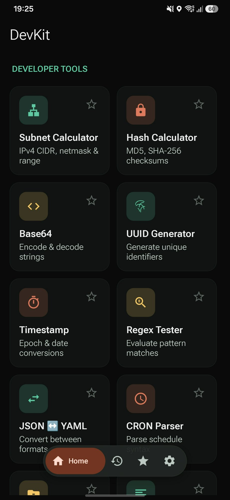
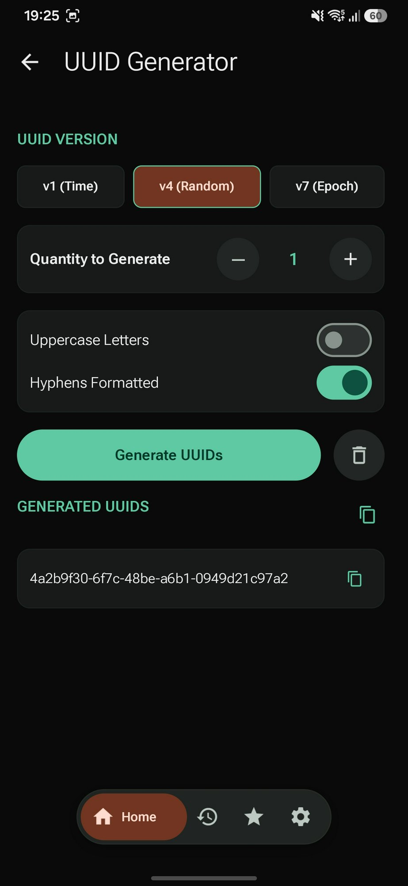
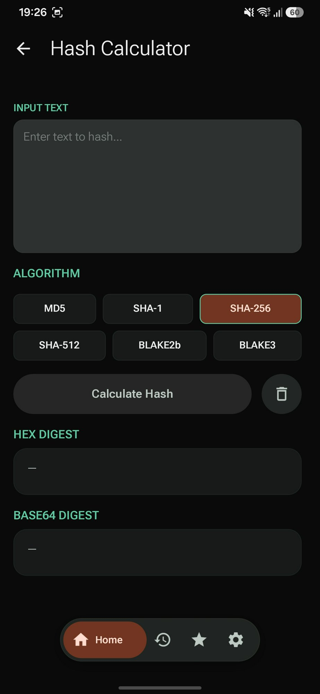
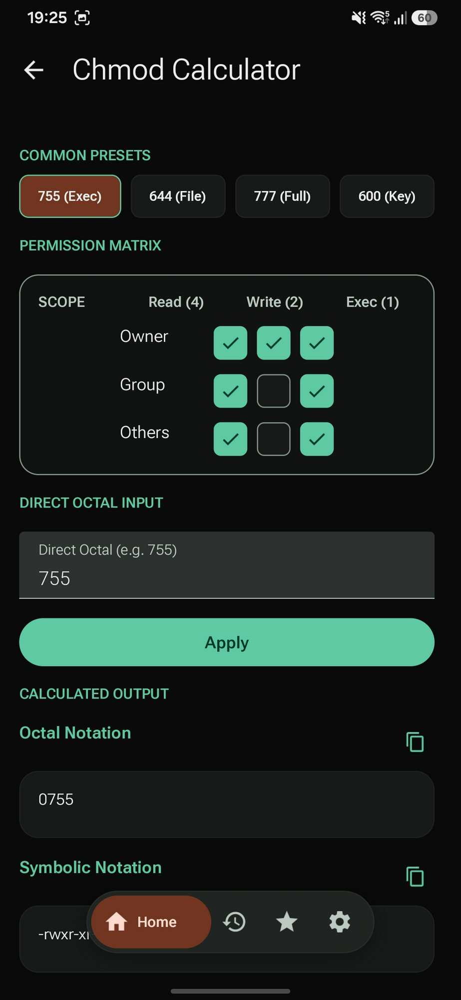
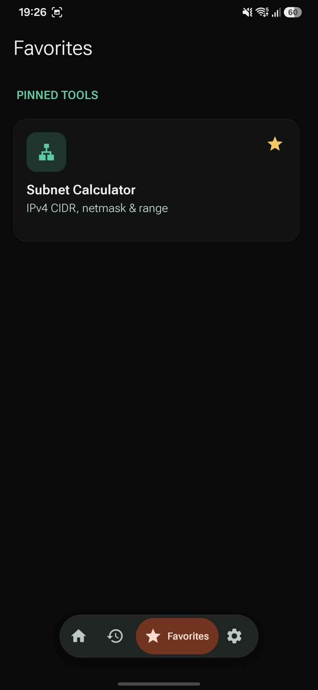
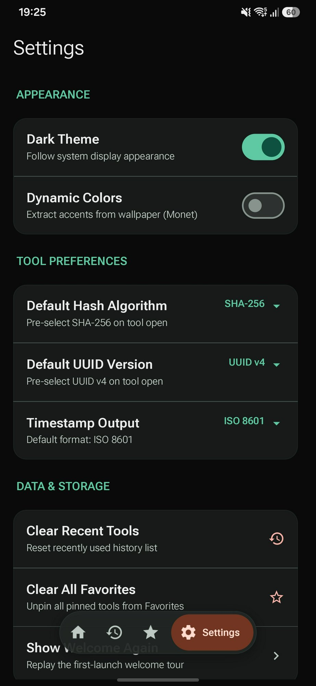

# DevKit

A modern, high-performance developer and sysadmin toolbox for Android, built entirely in **Rust** using the **[Slint](https://slint.dev)** UI toolkit and **Material Design 3**.

DevKit provides an offline-first suite of essential utility tools for software engineers, DevOps practitioners, and system administrators — with zero JVM UI overhead, native performance, and complete respect for privacy.

[](LICENSE)
[](https://slint.dev)
[](android/app/build.gradle)

---

## Screenshots

<p align="center">
  
  
  
</p>

<p align="center">
  
  
  
</p>

---

## Features

DevKit packs 19 dedicated developer tools designed for speed, ergonomics, and touch friendliness.

**Smart Paste:** tap the clipboard button in the Home search bar (or just paste into it) and DevKit recognises what you copied — JWT, cURL command, URL, IP/CIDR, timestamp, cron expression, color, JSON/YAML, Base64, `otpauth://` URI, domain — and opens the right tool already filled in.

### 🌐 Networking & Sysadmin
- **Subnet Calculator:** IPv4 CIDR calculations, netmask, network and broadcast addresses, usable IP range, host capacity, and binary mask breakdowns.
- **Chmod Calculator:** Linux permissions calculator featuring an interactive permission matrix (Owner, Group, Others × Read, Write, Execute), octal and symbolic (`rwxr-xr-x`) representations, and common presets (755, 644, 777, 600).
- **LAN Scout:** Discover live hosts on the local subnet, scan known developer services or custom port ranges (e.g. `22,80,8000-8100`), and hand an open port straight to the HTTP Client or TLS Inspector.
- **HTTP Client:** Pocket cURL: send requests, inspect status, TTFB, headers and pretty-printed JSON, import/export cURL commands.
- **TLS Inspector:** Handshake with any host to see protocol, cipher, ALPN, timings, trust verdict, hostname match and the full certificate chain (SANs, expiry countdown, key, SHA-256 fingerprint).

### 🔐 Cryptography & Identifiers
- **Hash Calculator:** Fast hashing supporting MD5, SHA-1, SHA-256, SHA-512, BLAKE2b, and BLAKE3 with one-tap Hex and Base64 digest output.
- **UUID Generator:** Bulk generation for UUID versions v1 (timestamp-based), v4 (random), and v7 (Unix Epoch time-ordered) with customizable casing and hyphen formatting.
- **JWT Decoder:** Inspect JSON Web Tokens with split header and payload decoding, signature inspection, algorithm recognition, and expiration validation.
- **QR Code Studio:** Generate customizable QR codes with adjustable Error Correction Levels (ECC) and integrated TOTP authenticator generation.

### 🔄 Data & Formats
- **Base64:** Encode and decode standard text and byte payloads, with support for URL-safe alphabets.
- **JSON ↔ YAML:** Seamless bidirectional converter and syntax validator between JSON and YAML.
- **GZip:** Compress and decompress text payloads on-device.
- **Code Formatter:** Prettify, indent, and format JSON, SQL, and HTML structures.
- **Diff Studio:** Side-by-side and unified textual diff comparison with added/deleted line statistics.

### ⏱️ Time & Regex
- **Timestamp Converter:** Convert bidirectionally between Unix Epoch timestamps (seconds, milliseconds, microseconds) and ISO 8601 / human dates, with live timestamp capture.
- **CRON Parser:** Parse standard cron schedule expressions, view human-readable summaries, and calculate next execution occurrences.
- **Regex Tester:** Live regular expression testing powered by Rust's regex engine, supporting match highlighting, capture groups, and regex flags.

### 🎨 Design & Accessibility
- **Color Converter:** Multi-format color tool converting between HEX, RGB, HSL, HSV, and CMYK, featuring an interactive color preview.
- **Contrast Checker:** Test foreground and background color combinations against WCAG 2.1 contrast guidelines, with AA/AAA compliance ratings for normal and large text.

---

## User Experience & Architecture

- **Material Design 3:** Clean, native-feeling UI with full Dark Theme support and Android 12+ Monet Dynamic Colors (accent extraction from system wallpaper).
- **Floating Pill Navigation:** Bottom navigation bar offering fluid access to Home, Recent tools, Favorites, and Settings.
- **Favorites & Recents:** Pin frequently used tools for immediate access and quickly resume recent tasks.
- **Adaptive Layout:** Responsive multi-column grid adapting from compact phones (2 columns) to foldables (3 columns) and tablets (4 columns).
- **100% Native Rust:** Built without JVM-side UI frameworks via Slint and `android-activity` (`backend-android-activity-06`).
- **Privacy-First & Offline:** Fully offline operation. No network analytics, no telemetry, no tracking, and no ads.

---

## Tech Stack

- **Language:** Rust (2021 edition)
- **UI Framework:** [Slint](https://slint.dev)
- **Design System:** Material 3 via Slint component architecture
- **Android Runtime:** `android-activity` (`backend-android-activity-06`) via `cargo-apk`
- **Minimum SDK:** 26 (Android 8.0 Oreo)
- **Target SDK:** 35 (Android 15)
- **Architectures:** `aarch64-linux-android`, `armeabi-v7a`, `x86_64`

---

## Download & Installation

Pre-built signed APKs and Android App Bundles (.aab) are available on the [GitHub Releases](https://github.com/M-Tre-Consulting/devkit/releases) page.

---

## Building and Running

### Prerequisites

- Rust stable toolchain with Android targets:
  ```bash
  rustup target add aarch64-linux-android
  ```
- `cargo-apk` build tool:
  ```bash
  cargo install cargo-apk
  ```
- Android SDK (API 35 platform and build-tools) and NDK (r26+)
- JDK 17+ (e.g., Android Studio's bundled JBR)

### Running on a Device / Emulator

To compile and launch directly on a connected device or active emulator:

```bash
PATH=/opt/android-studio/jbr/bin:$PATH cargo apk run --target aarch64-linux-android --lib
```

> **Note:** Setting `JAVA_HOME` alone is not sufficient because `apksigner` requires the `java` binary to be present directly in `PATH`.

### Building Android App Bundle (.aab)

- **Linux / WSL:**
  ```bash
  ./scripts/build-aab.sh target/release/apk/devkit.apk target/release/bundle/devkit.aab
  ```

- **Windows (PowerShell):**
  ```powershell
  .\scripts\build-aab.ps1
  # To compile the APK first and export the AAB:
  .\scripts\build-aab.ps1 -BuildApk
  ```

- **Windows (CMD / Batch):**
  ```cmd
  scripts\build-aab.bat
  ```

---

## Project Structure

```
assets/
└── screenshots/         Repository screenshots and store presentation assets
fastlane/
└── metadata/android/    Fastlane metadata for alternative stores (F-Droid, IzzyOnDroid)
ui/                      Slint UI markup, components, and screen layouts
├── components/          Shared UI components (floating pill nav, tool cards, text areas)
├── icons/               SVG icon vector assets
├── images/              Branding and graphics assets
└── screens/             Screen definitions for each tool, settings, and navigation views
src/                     Rust application backend and business logic
├── platform/            Android JNI bridge, window insets, clipboard & native integration
├── storage.rs           Local preferences, favorites, and recents persistence
└── tools/               Calculation, parsing, and transformation engines for all 18 tools
```

---

## Roadmap

- [ ] Tablet two-pane split layout for simultaneous input and output on large screens
- [ ] Export and import application settings and saved preferences
- [ ] Home screen quick-action shortcuts for pinned favorite tools
- [ ] Extended character encoding options for text-based tools

---

## License

DevKit is licensed under the Apache License, Version 2.0.
See [LICENSE](LICENSE) for the full text.

### Third-Party Licenses

This project uses the [Slint UI framework](https://slint.dev),
licensed under the Slint Royalty-free Desktop, Mobile, and Web
Applications License. See [NOTICE](NOTICE) for attribution details.

---

## Acknowledgements

- Built with [Slint](https://slint.dev) — a Rust UI toolkit for native applications.
- Material Design 3 is designed by Google.
